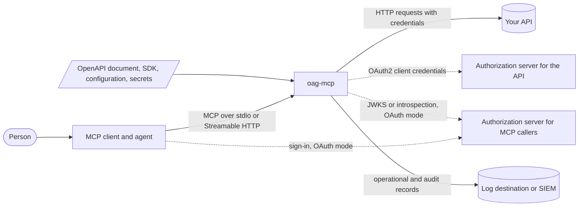
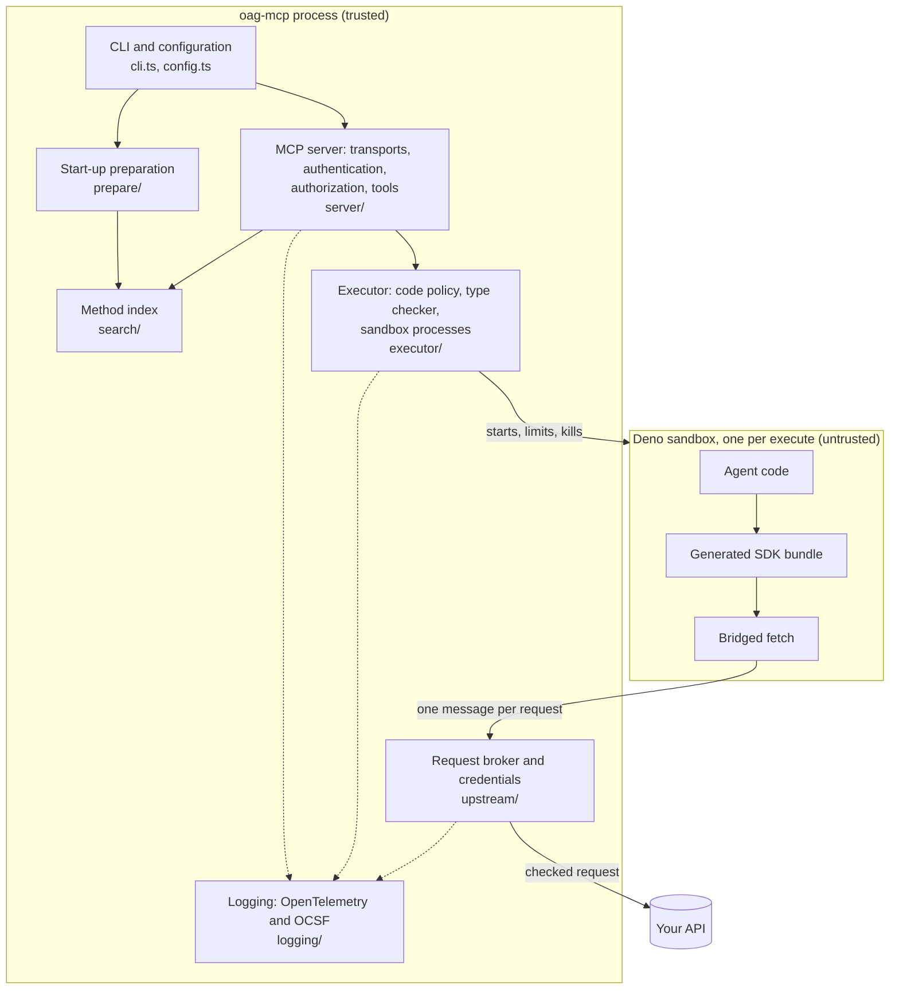
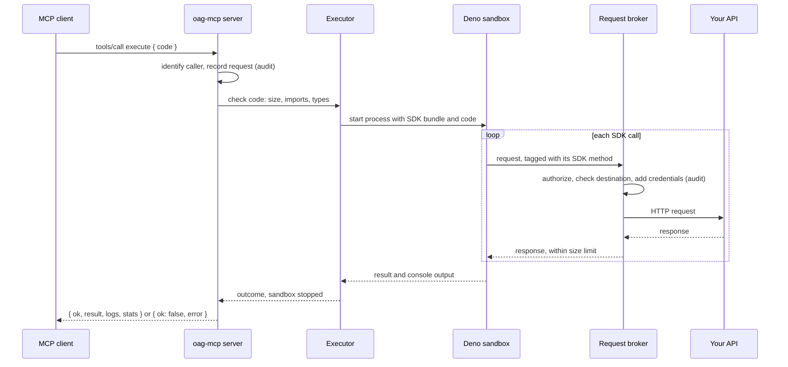

# Architecture

OAG-MCP turns an OpenAPI document and the typescript-fetch SDK generated from
it into an MCP server, so that AI agents can use the API. Instead of one MCP
tool per operation, it exposes two: `search`, to find SDK methods, and
`execute`, to run TypeScript that calls them. The agent's code runs with the
real SDK in a sandbox without permissions; every request the SDK makes is
checked, given credentials and sent by oag-mcp itself, outside the sandbox.

```mermaid
flowchart LR
  inputs[/"OpenAPI document,<br/>SDK (read-only),<br/>configuration"/]
  subgraph startup["Start-up, once"]
    direction TB
    s1["1. Read command line<br/>and configuration"] --> s2["2. Read OpenAPI document<br/>and SDK"]
    s2 --> s3["3. Check SDK compatibility"]
    s3 --> s4["4. Bundle SDK and<br/>declarations"]
    s4 --> s5["5. Index SDK methods"]
    s5 --> s6["6. Credentials, policy,<br/>sandbox check"]
    s6 --> s7["7. Register tools,<br/>open transport"]
  end
  subgraph serving["Serving, every call"]
    direction TB
    caller["Authenticate caller"] --> search["search"]
    caller --> execute["execute"]
    search --> index[("Method index,<br/>filtered by permissions")]
    execute --> check["Code policy<br/>and type check"]
    check --> sandbox["Deno sandbox:<br/>agent code and real SDK"]
    sandbox --> broker["Host broker: authorization,<br/>network policy, credentials"]
  end
  inputs --> s1
  s7 -- "stdio or<br/>Streamable HTTP" --> caller
  broker --> api[("Your API")]
```



The numbered steps are those of [How it works](how-it-works.md), which
follows each one in turn.

Goals:

- **Make any OpenAPI API usable by agents** with only what the API already
  has: its OpenAPI document and a generated SDK. No hand-written tools, no
  changes to the API or the SDK.
- **Keep the agent's context small** whatever the size of the API, and let
  it compose many calls into one program
  ([ADR 1](decisions/0001-code-mode-with-two-tools.md)).
- **Treat agent code as untrusted**: it never sees credentials, and can only
  reach the operations a caller is allowed, on the configured API
  ([ADR 2](decisions/0002-real-sdk-in-a-deno-sandbox.md)).
- **Leave a complete, standard record** of what each caller did
  ([ADR 7](decisions/0007-logging-in-opentelemetry-and-ocsf.md)).

[How it works](how-it-works.md) follows what happens step by step; this page
describes the structure behind it.

OAG-MCP does not have formal service-level targets. These are the properties
it is designed for, how it achieves them, and what has been observed with the
test API (11 operations) on a developer machine.

| Attribute | Design | Observed |
| --- | --- | --- |
| Security | Agent code in a separate Deno process with no permissions; credentials and network only on the host side; per-operation authorization; secrets never logged; refuses to listen beyond loopback without MCP authentication. See [Security](security.md). | Every escape attempt in the integration tests (files, network, environment, subprocesses, `eval`, forged bridge messages) is denied and audited. |
| Start-up | Everything is prepared at start-up, once, with no cache ([ADR 5](decisions/0005-prepare-at-start-up-without-a-cache.md)). | 1.7 to 6 seconds, varying with machine load; grows with the size of the SDK. |
| Latency | `search` answers from memory; each `execute` starts a fresh sandbox process. | `search` about 1 ms. `execute` of trivial code 50 to 90 ms, the first call or two a few hundred ms more; each SDK call adds the API's own response time. |
| Concurrency | Executions run in separate processes, up to `execution.maxConcurrent` (default 4), with a bounded queue; each has its own memory limit. See [Execution limits](recipes/execution-limits.md). | Calls beyond the queue are refused at once with `executor_busy`, without affecting running ones. |
| Scalability | One process per server; Streamable HTTP is stateless, so instances can be added behind a load balancer ([ADR 8](decisions/0008-stateless-streamable-http.md)). | Not load-tested. |
| Availability | Fails fast at start-up rather than serving partially; stdout carries only MCP messages; a failing audit destination can stop `execute` (fail-closed) instead of running unaudited. | |
| Maintainability | Strict TypeScript; cyclomatic complexity at most 10 for every function in `lib/`; one adapter knows the SDK layout ([ADR 3](decisions/0003-typescript-fetch-sdks-only.md)). | 100% line coverage by unit tests; audit records validated against the OCSF schema in CI. |

## Tech stack

| Part | Technology | Why |
| --- | --- | --- |
| Language and runtime | TypeScript, on Node.js 22 or later | Typed throughout, and the MCP, TypeScript compiler and bundler tools it builds on are Node.js libraries. |
| MCP | `@modelcontextprotocol/server`, `@modelcontextprotocol/node` | The official SDK, for both transports and OAuth resource server support. |
| Sandbox | Deno 2, from the `deno` npm package | A separate process with a deny-by-default permission model, and the standard web runtime typescript-fetch SDKs target ([ADR 2](decisions/0002-real-sdk-in-a-deno-sandbox.md)). |
| OpenAPI | `@apidevtools/swagger-parser`, `openapi-sampler` | Validates and dereferences documents without fetching remote references; generates example values. |
| SDK analysis | TypeScript compiler API (`typescript`) | Reads the generated code to bind methods, extracts exact signatures, emits declarations and type-checks agent code against them ([ADR 4](decisions/0004-bind-methods-by-static-analysis.md)). |
| Bundling | `esbuild` | Turns the SDK and its dependencies into one module the sandbox can load. |
| Search | `minisearch`, `stopword`, `stemmer` | An in-memory full-text index with English stop words and stemming, small enough to build at every start-up. |
| Authentication | `jose` | Validates JWT access tokens for OAuth MCP callers against the issuer's keys. |
| Configuration | `yaml`, `zod` | YAML or JSON files, validated strictly against one schema. |
| Logging | `pino`, `pino-pretty`, `sonic-boom` | Fast structured logging with synchronous writes, so a failing audit destination is noticed at once ([ADR 7](decisions/0007-logging-in-opentelemetry-and-ocsf.md)). |
| Packaging | `tar`, `semver`, `which` | Safe extraction of SDK archives, generator and Deno version checks, finding Deno on `PATH`. |
| CLI | `bagofcli` | Command and option definitions, with validation, from `conf/commands.json`. |
| Build | Olympia Makefile, `tsc`, ESLint, Prettier, Mocha, c8, TypeDoc | The standard tooling of Olympia projects ([ADR 9](decisions/0009-typescript-and-olympia-build.md)). |

## Diagrams

OAG-MCP sits between MCP clients and the API. It reads its inputs at
start-up, and talks to authorization servers only when the configuration
uses OAuth.



Everything runs in one oag-mcp process, except agent code, which runs in a
separate sandbox process for each `execute` call. The sandbox has no way out
except the bridge to the request broker.



The main data path: the agent's code, its SDK calls, and the result.



`search` needs no diagram: the server answers it from the method index,
filtered by what the caller may call, without the sandbox or the API.

## Repo structure

```text
bin/oag-mcp.js        command entry point; loads dist/cli.js
conf/commands.json    CLI commands, options and their validation
lib/                  TypeScript sources
  cli.ts              the serve command: configuration, logging, signals, start and stop
  config.ts           configuration schema and loading
  errors.ts           OagMcpError: stable error codes and hints
  types.ts            data shared between areas (operations, principals, …)
  prepare/            start-up preparation: inputs, compatibility, bundle, method index
  search/             the in-memory search index
  server/             transports, MCP authentication, authorization, the two tools
  executor/           code policy, type checker, Deno sandbox processes
  upstream/           request broker, security requirements, credential providers
  logging/            the logger, OpenTelemetry and OCSF formats
  util/               hashing, redaction, secrets, semaphore, version
assets/deno-runner.js the program that runs inside the sandbox (JavaScript, not compiled)
test/                 unit tests, mirroring lib/, with fixtures (including the Pet Clinic API and SDKs)
test-integration/     integration tests: the CLI as a process, a mock API, a local authorization server
examples/             example configuration and CLI usage
docs/                 user documentation, reference pages and decision records
```

The code is organised by responsibility, not by layer. These rules keep the
responsibilities apart:

- **Dependencies point one way.** At run time, `cli` uses `server`; `server`
  uses `prepare`, `search`, `executor` and `upstream`; all of them use
  `logging`, `util`, `config` and `errors`. Where a module needs a type from
  an area that depends on it, it imports the type only (`import type`), so
  there are no cycles at run time.
- **One place for each boundary.** Only `executor/` starts sandbox processes.
  Only `upstream/` sends requests to the API and handles upstream
  credentials. Only `prepare/compat.ts` and `prepare/analyze.ts` know the
  typescript-fetch layout. Only `assets/deno-runner.js` runs inside the
  sandbox, and it imports nothing from `lib/`.
- **Contracts are interfaces.** The tools depend on `Executor`
  (`lib/executor/types.ts`), not on Deno, and the broker on
  `CredentialProvider` (`lib/upstream/types.ts`), which receives the caller.
  These are where another sandbox or a per-caller credential provider would
  plug in.
- **No logging around the logger.** Library code logs through `Logs`, never
  `console`, and never writes to stdout, which carries MCP messages.

Where each kind of type lives, and other code conventions, are in
[AGENTS.md](../AGENTS.md) and [AGENTS-extras.md](../AGENTS-extras.md#where-types-live).

## Decision records

The significant design decisions, each with its context, the choice made and
its consequences, are in [decisions/](decisions/README.md):

1. [Code mode with two tools](decisions/0001-code-mode-with-two-tools.md)
2. [The real SDK in a Deno sandbox, with a host broker](decisions/0002-real-sdk-in-a-deno-sandbox.md)
3. [typescript-fetch SDKs only](decisions/0003-typescript-fetch-sdks-only.md)
4. [Bind SDK methods to operations by static analysis](decisions/0004-bind-methods-by-static-analysis.md)
5. [Prepare at start-up, without a persistent cache](decisions/0005-prepare-at-start-up-without-a-cache.md)
6. [One shared upstream identity, no token passthrough](decisions/0006-shared-upstream-identity.md)
7. [Logging in OpenTelemetry and OCSF](decisions/0007-logging-in-opentelemetry-and-ocsf.md)
8. [Stateless Streamable HTTP](decisions/0008-stateless-streamable-http.md)
9. [TypeScript and the Olympia build](decisions/0009-typescript-and-olympia-build.md)

## Deployment and operations

OAG-MCP is one process, with short-lived Deno processes under it for
executions. It runs in one of two ways:

- **Local, over stdio**: an MCP client on the same machine starts it as a
  subprocess, one per client. Nothing listens on the network.
- **As a service, over Streamable HTTP**: on a server or in a container,
  behind a reverse proxy that provides HTTPS, with MCP authentication. Being
  stateless, it can run as several instances behind a load balancer. See
  [Remote server](recipes/remote-server.md) and [Deployment](deployment.md).

It needs Node.js 22 or later, its own npm dependencies (including Deno), the
OpenAPI document, the SDK and the configuration. It does not need OpenAPI
Generator or Docker, nor network access at start-up, except to reach the
authorization server when MCP callers use OAuth. It writes only to its
temporary folders and its log files.

Settings come from command-line flags and one configuration file, validated
strictly at start-up; see the [CLI](reference/cli.md) and
[configuration](reference/configuration.md) references. Secrets are never in
either: the configuration references them, by environment variable or by key
in a secrets file only its owner can read, and they are resolved when the
server starts. Agent code never has access to them, and they are scrubbed
from every log line and result.

The temporary workspace, under `TMPDIR`, holds the prepared SDK. It contains
no secrets and is removed when the server stops; on a read-only root
filesystem, point `TMPDIR` at a writable volume.

OAG-MCP writes two kinds of log, to stderr by default, or to files or file
descriptors: operational records in OpenTelemetry's format, and security
audit records in OCSF. See [Logging](logging.md), the
[log events reference](reference/log-events.md) and
[Audit logging](recipes/audit-logging.md).

Readiness is the `server.ready` record and, over HTTP, the
`oag-mcp listening on <url>` line on stderr. Over HTTP, `GET /healthz`
answers `{"status":"ok"}` without authentication, subject to the `Host` check.

OAG-MCP exposes no metrics endpoint and emits no traces. Counts and durations
are in the operational records (`execution.completed`,
`upstream.call.completed`, …), so metrics can be derived from them by a log
pipeline, such as an OpenTelemetry Collector.
